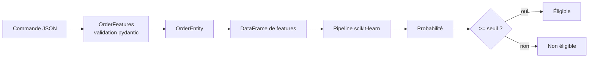
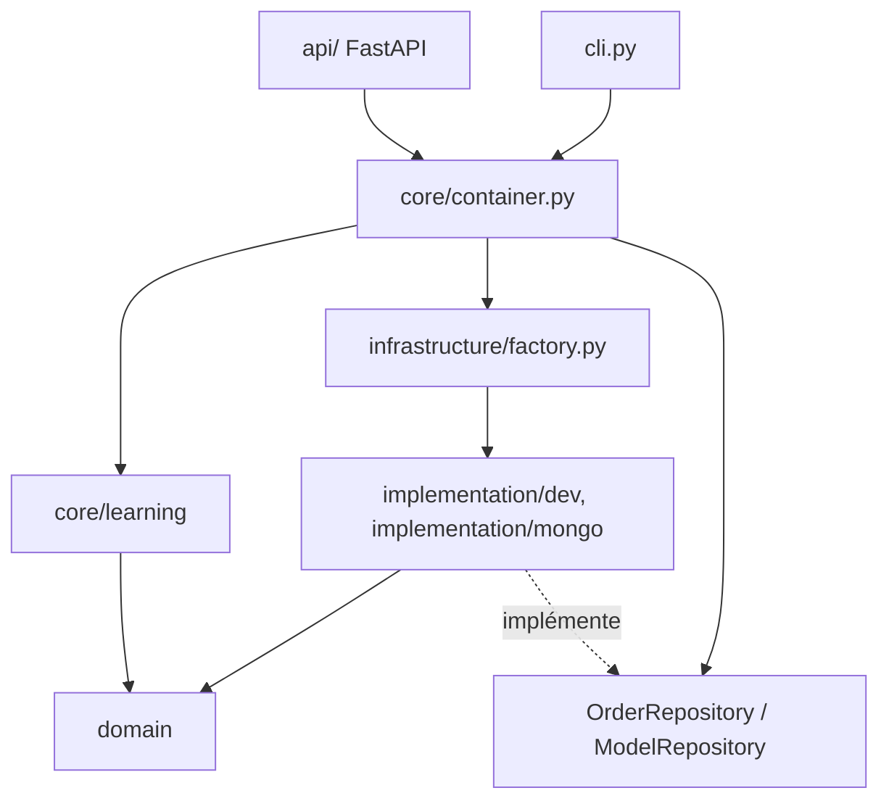
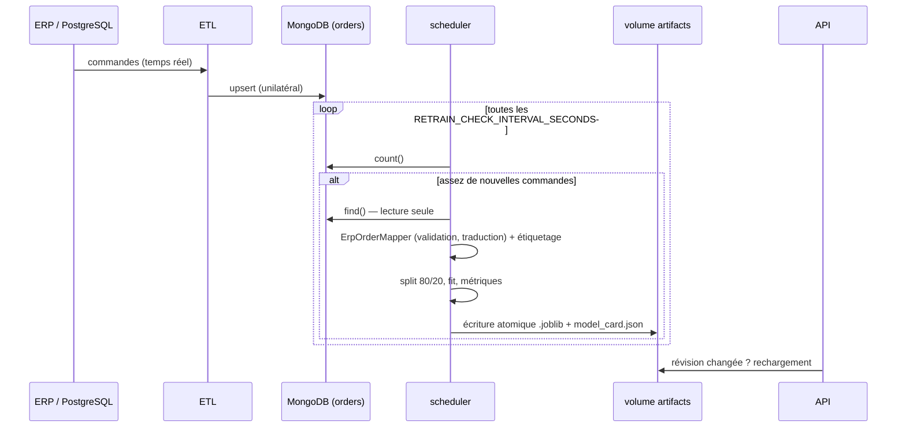

# Architecture logicielle

## 1. En une minute
`livraison_express` prédit si une commande peut être livrée en express. Le principe central
est la séparation entre **entraîner** (job `train` / `scheduler`) et **servir** (API qui charge
un artefact) : l'API ne réentraîne jamais.

## 2. Couches et dépendances

| Couche | Question | Exemples |
|---|---|---|
| `domain` | Qu'est-ce qu'une commande, une prédiction, un modèle ? | `OrderEntity`, `PredictionEntity`, `ModelEntity`, erreurs |
| `core/learning` | Comment transformer les données et utiliser le modèle ? | `build_model_pipeline`, `MLTrainer`, `MLPredict`, `BusinessRuleLabeler` |
| `core` | Comment assembler et orchestrer ? | `Container`, `RetrainingScheduler` |
| `infrastructure` | Où sont les données et l'artefact ? | mémoire, MongoDB, fichiers joblib |
| `api` | Comment exposer le service HTTP ? | FastAPI, schémas OpenAPI |

Seuls `infrastructure/factory.py` et `core/container.py` connaissent les classes concrètes :
passer de la mémoire à MongoDB est un changement de configuration (`ORDER_REPOSITORY_URL`).

## 3. Flux de données (séance 4)

## 4. Qualité des données
- `ErpOrderMapper` valide chaque document (types, bornes, valeurs) et traduit le vocabulaire
  de l'ERP ; un document invalide est écarté et compté, jamais propagé.
- À l'entrée de l'API, `OrderFeatures` (`extra="forbid"`) rejette toute variable absente, en
  trop ou hors domaine (422).
- `order_id` et la cible ne sont jamais des features.

## 5. Principes appliqués
| Principe | Illustration |
|---|---|
| **S**ingle responsibility | le splitter sépare, le trainer entraîne, le predictor prédit, le mapper traduit, le repository stocke |
| **O**pen/closed | ajouter MongoDB n'a modifié ni le trainer, ni l'API |
| **L**iskov | toutes les implémentations passent les mêmes tests de contrat |
| **I**nterface segregation | `Labeler`, `OrderDocumentMapper` : interfaces minimales |
| **D**ependency inversion | le cœur dépend des abstractions ; la fabrique choisit l'implémentation |
| DRY | colonnes définies une seule fois (`order_feature.py`) |
| KISS / YAGNI | scheduler plutôt qu'Airflow, fichier local plutôt qu'un model registry, tant que le besoin ne l'exige pas |

## 6. Tests
| Niveau | Fichier | Doublure |
|---|---|---|
| Unitaire | `tests/unit/test_learning.py`, `test_erp_mapper.py`, `test_retraining.py` | faux modèle |
| Contrat | `tests/unit/test_order_repository_contract.py` | mémoire, mongomock |
| API | `tests/unit/test_api.py` | `TestClient`, modèle entraîné sur 800 lignes |
| Intégration | `tests/integration/test_mongo_integration.py` | vrai MongoDB (service CI) |

## 7. Limites connues et trajectoire
1. Labels issus de la règle métier (ADR-0006) en attendant le retour terrain.
2. Pas de model registry ni de rollback de modèle automatique (ADR-0000).
3. Prédiction par lot, historique des prédictions et métriques Prometheus : prévus aux
   séances suivantes (`x-session` 5 et 7 du contrat OpenAPI).
4. Une seule instance d'API : passage à Kubernetes à réévaluer (ADR-0002).
